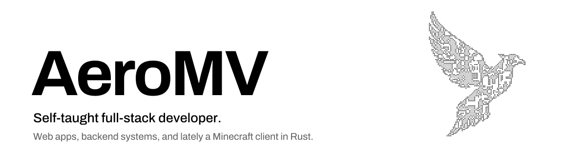
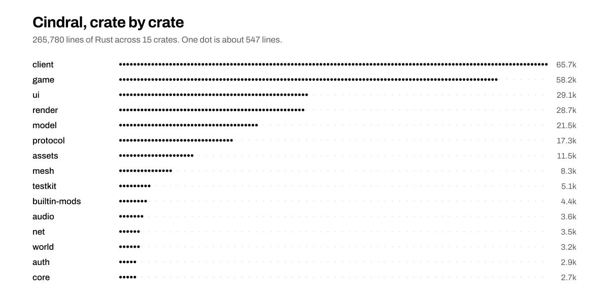
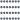
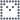

<picture>
  <source media="(prefers-color-scheme: dark)" srcset=".assets/banner-dark.svg">
  
</picture>

I'm AeroMV, a self-taught full-stack developer. I build web apps and the backend behind them, from the UI down to the database. Most of it is for private clients and communities, so it stays in private repos. What I can share is below.

Right now most of my evenings go into Cindral, a Minecraft client I'm writing in Rust.

## <picture></picture> Things I built

**[Cindral](https://github.com/aeromv/cindral)** <picture></picture> <picture></picture> 
A standalone Minecraft 1.8.9 client for PvP. It doesn't run on top of the Java game: networking, world, renderer and UI are its own, on Direct3D 12 or Vulkan. Made so a laptop with integrated graphics can still hold a few hundred FPS in a fight. 14 built-in mods, a drag-and-drop HUD editor, Microsoft login, resource packs. No autoclicker or reach, and there won't be.

<picture>
  <source media="(prefers-color-scheme: dark)" srcset=".assets/cindral-chart-dark.svg">
  
</picture>

## <picture></picture> Forks I maintain

- **[discord.js-selfbot-v13](https://github.com/aeromv/discord.js-selfbot-v13)** <picture></picture> 
  Better recovery when Discord's REST or gateway misbehaves: one keep-alive pool, duplicate GETs merged, 5xx retried with backoff, one missed heartbeat no longer drops the connection
- **[Chione](https://github.com/aeromv/Chione)** <picture></picture> 
  Autoclicker and movement tool for 1.7/1.8 PvP. I fixed CPS drift and hotkeys dying after alt-tab, added AZERTY and Arabic layouts, and set up the Windows builds

## <picture></picture> What I use

<picture></picture>
<picture></picture>
<picture></picture>
<picture></picture>
<picture></picture>
<picture></picture>
<picture></picture>
<picture></picture>
<picture></picture>

TypeScript and Node for most things. Rust when speed actually matters, Python for small tools.

## <picture></picture> Get in touch

Email [contact@aeromv.com](mailto:contact@aeromv.com) • Site [aeromv.com](https://www.aeromv.com) • [Twitter](https://twitter.com/aeromv_lab) • [Instagram](https://instagram.com/aeromv_lab)
