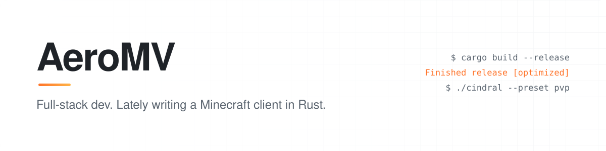

<picture>
  <source media="(prefers-color-scheme: dark)" srcset="assets/banner-dark.svg">
  
</picture>

I'm AeroMV, a self-taught developer. I mostly do full-stack web work: the UI, the API behind it, and the database under that. Lately I've been spending my evenings on something lower level, a Minecraft client written from scratch in Rust.

I care more about things working well than looking clever. If a feature can be cut and nobody misses it, it probably should be.

[aeromv.com](https://www.aeromv.com) · [contact@aeromv.com](mailto:contact@aeromv.com) · [Twitter](https://twitter.com/aeromv_lab) · [Instagram](https://instagram.com/aeromv_lab)

## Things I built

### [Cindral](https://github.com/aeromv/cindral)

A standalone Minecraft 1.8.9 client for PvP. It doesn't sit on top of the Java game. The networking, world, renderer and UI are all its own, built on [wgpu](https://wgpu.rs) (Direct3D 12 on Windows, Vulkan on Linux).

The goal was simple: a laptop with integrated graphics should still push a few hundred FPS in a PvP arena. Game logic runs on its own thread at 20 TPS so it never stalls a frame.

- 14 built-in mods (keystrokes, CPS, armor status, zoom, motion blur...) behind one menu, plus a drag-and-drop HUD editor
- Microsoft login with an account switcher, resource packs, server packs
- No autoclicker, no reach, nothing that gives an unfair edge. That's on purpose.
- Split into 15 crates: protocol, net, world, mesh, render, ui, and so on

`Rust` `wgpu` `Vulkan` `D3D12`

### Forks I maintain

| Project | What I changed |
| --- | --- |
| [discord.js-selfbot-v13](https://github.com/aeromv/discord.js-selfbot-v13) | Reworked how REST and the gateway recover from failures: a shared keep-alive pool, deduped GETs, 5xx retries with backoff and jitter, more forgiving heartbeats. Same API as upstream. |
| [Chione](https://github.com/aeromv/Chione) | External autoclicker and movement tool for 1.7/1.8 PvP, written in Python. Fixed CPS drift, hotkeys dying after alt-tab, AZERTY and Arabic keyboard support, and set up Windows builds plus a smoke test in CI. |

Most of my other work (websites, Discord bots, Minecraft server plugins) lives in private repos for clients and communities I work with.

## What I work with

Day to day it's TypeScript, React and Node. Rust when performance actually matters. Python for scripts and tooling.

---

Open to collaborating on open-source stuff. If something here is broken or you have an idea, open an issue or just email me.
